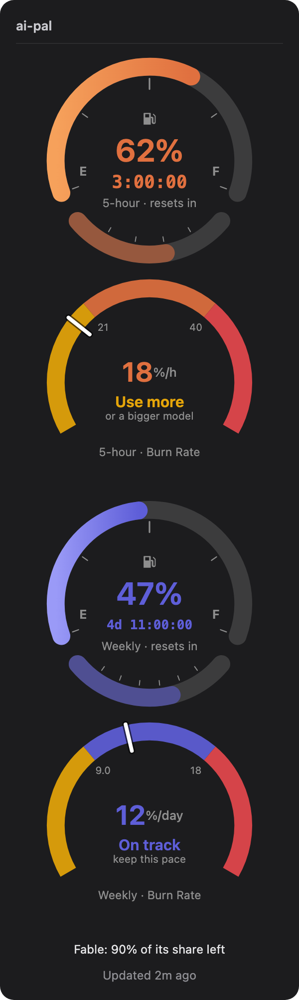
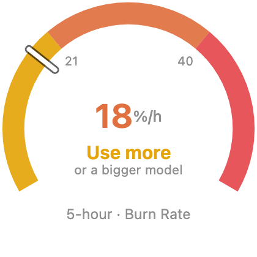
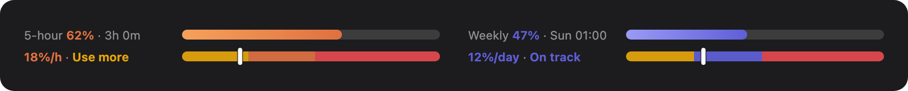

# ai-pal

**A Claude Code mod that shows how much of your Claude plan you have left, and nudges you before a Reset throws it away.**

A Claude plan meters usage in windows: a 5-hour window, a weekly window, and sometimes a weekly window per model. Whatever you haven't used when a window resets is lost. Claude's own meter warns you near a cap, but nothing tells you that allowance you've already paid for is about to go unused. ai-pal does.

<p align="center"></p>

## What it does

**It shows where you stand.** A Pane docked beside your session holds four car-style dials in a column, a fuel gauge and a speedometer for each window. The fuel gauge shows the share of the window you have left from E to F, the time to its Reset draining on the arc below, and a clock counting down to the second. The speedometer shows that window's Burn Rate. `/ai-pal set gauges needle` swaps the rings for needle dials, and `ring` brings back a single split ring with the 5-hour speedometer. Under the dials is a row per model-specific window.

**It judges your pace.** ai-pal counts your Active Use (5-minute slots in which Claude ran a turn) and how fast you spend each window during it. It then makes a Pace Call per window:

- **Use more**, or a bigger model: at this rate some of the window would go unused.
- **On track**: your pace spends it by the Reset.
- **Ease off**, or a lighter model: you'd run out well before the Reset.

Each speedometer gives the three calls a third of its dial each: amber for Use more, the window's colour for On track, red for Ease off.

<p align="center"></p>

**It keeps the key figures where you type.** A band above the prompt shows each window's Unused Allowance over a speed bar with your rate and the Pace Call. Hover a window in the band for the reason behind the call.

<p align="center"></p>

**It nudges you after you've left.** A native notification arrives shortly before a Reset when a window still has enough left. It goes 1 hour before a 5-hour Reset when 40% or more is left, and 24 hours and 3 hours before a weekly Reset when 30% or more is left. It's held while you're in front of a session, so it only reaches you once you've stepped away:

```text
5-hour: 62% left as of 14:00, resets in 1h. Even nonstop, ~44% would go unused. Try a bigger model.
```

Nudges stay quiet during your Quiet Hours (23:00–08:00 by default). A weekly Nudge that would land in them moves to just before they start. A 5-hour and a weekly Nudge due within 30 minutes of each other arrive as one notification.

**It's honest about old figures.** A Reading older than 15 minutes fades and gets a `~`, and the footnote under the dials always says how old the figures are. A window whose Reset has passed shows a dashed `Reset` rather than an assumed full window.

## Install

ai-pal needs Claude Code 2.1.325 or newer and a Claude subscription (Pro or Max).

At the prompt of a terminal session:

```text
/plugin install ai-pal --marketplace hbfelizzola/ai-pal
```

Answer `y` to add the marketplace, then pick a scope. From a shell:

```bash
claude plugin install ai-pal --marketplace hbfelizzola/ai-pal
```

In the Claude desktop app, where `/plugin` doesn't run: click **+** next to the prompt box, then **Plugins**, **Add marketplace** with `hbfelizzola/ai-pal`, then **Add plugin**.

The Pane opens by itself when a session starts. The figures fill in after your first message, or within a few seconds when the usage endpoint answers.

## Settings: `/ai-pal`

`/ai-pal` on its own lists every setting with its default, each booked Nudge with the text it will send, and why a window has none. Change a setting with `/ai-pal set <setting> <value>`, and restore one or all with `/ai-pal reset [setting]`. A change re-plans the Nudges at once and tells you what was booked or cancelled.

| Setting | Values | Default |
| --- | --- | --- |
| `nudges` | `on` or `off` | `on` |
| `5h-threshold` | a whole % from 5 to 100, or `off` | `40%` |
| `weekly-threshold` | a whole % from 5 to 100, or `off` | `30%` |
| `quiet-hours` | `HH:MM-HH:MM` in 24-hour local time (may cross midnight), or `off` | `23:00-08:00` |
| `band` | `on` or `off` | `on` |
| `gauges` | `fuel` (fuel-gauge rings), `needle` (needle dials) or `ring` (one split ring) | `fuel` |

## How it reads your usage

ai-pal takes the usage figures your session reports after every response. It also asks your plan's usage endpoint at `api.anthropic.com` every 5 minutes, signed in as your session (the mod never sees your credential). Only the endpoint reports model-specific weekly windows. ai-pal backs off when the endpoint is busy, and falls back to the session's own figures when the endpoint refuses or changes shape.

Everything ai-pal records stays on your machine, in its own Claude Code data: your Readings (7 days for the 5-hour window, 4 weeks for weekly ones), your Active Use and your settings. Every open session shares the same figures. Nothing goes to the author or any third party; the [privacy policy](PRIVACY.md) has the details.

## Limits

- **Nudges are booked from the desktop app only.** A terminal shows a notification at once instead of when it's due, so a terminal session shows the readout but books no Nudges.
- **After you quit**, a booked Nudge fires only if the desktop app keeps it, and its text says how old its figure is. A Mac that's asleep delivers it late.
- **Usage on claude.ai or your phone** raises the figures without adding Active Use, which makes your Burn Rate read high.

## Development

The mod lives in [`mod/`](mod). Its tests drive it only through its edge with the Claude Code engine (engine events in, what's drawn, booked or stored out), on both the terminal and desktop surfaces:

```bash
claude plugin test mod
```

Load it into one session from the repo with:

```bash
claude --plugin-dir mod
```

[`CONTEXT.md`](CONTEXT.md) defines the vocabulary: Usage Window, Reset, Unused Allowance, Reading, Nudge, Active Use, Burn Rate and Pace Call. The v1 spec is [#18](https://github.com/hbfelizzola/ai-pal/issues/18).

## License

[MIT](LICENSE)
