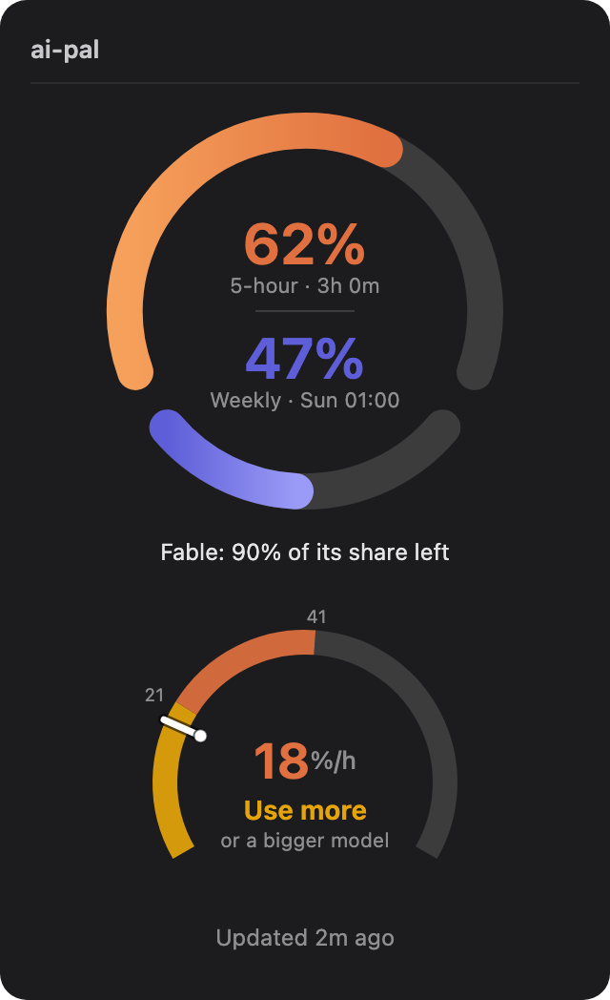
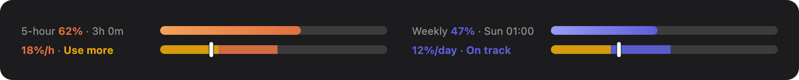

# ai-pal

**Shows how much of your Claude plan you have left, and nudges you before a Reset throws it away.**

A Claude plan meters usage in windows: a 5-hour window, a weekly window, and sometimes a weekly window per model. Whatever you haven't used when a window resets is lost. Claude's own meter warns you near a cap, but nothing tells you that allowance you've already paid for is about to go unused. ai-pal does.



## What it does

**It shows where you stand.** A Pane docked beside your session holds a split ring with the share of each window you have left and the time to its Reset. The 5-hour window gets the larger arc, across the top. Under the ring are a row per model-specific window and a speedometer for your 5-hour Burn Rate.

**It judges your pace.** ai-pal counts your Active Use (5-minute slots in which Claude ran a turn) and how fast you spend each window during it, then makes a Pace Call per window:

- **Use more**, or a bigger model: at this rate some of the window would go unused.
- **On track**: your pace spends it by the Reset.
- **Ease off**, or a lighter model: you'd run out well before the Reset.

**It keeps the key figures where you type.** A band above the prompt shows each window's Unused Allowance over a speed bar with your rate and the Pace Call. Hover a bar for the reason behind the call.



**It nudges you after you've left.** A native notification arrives shortly before a Reset when a window still has enough left: 1 hour before a 5-hour Reset with 40% or more left, and 24 hours and 3 hours before a weekly Reset with 30% or more left. It's held while you're in front of a session, so it only reaches you once you've stepped away. For example:

> 5-hour: 62% left as of 14:00, resets in 1h. Even nonstop, ~44% would go unused. Try a bigger model.

Nudges stay quiet during your Quiet Hours (23:00–08:00 by default). A weekly Nudge that would land in them moves to just before they start, and a 5-hour and a weekly Nudge due within 30 minutes of each other arrive as one notification.

**It's honest about old figures.** A Reading older than 15 minutes fades and gets a `~`, and the footnote under the ring always says how old the figures are. A window whose Reset has passed shows a dashed `Reset` rather than an assumed full window.

## Install

ai-pal needs Claude Code 2.1.325 or newer and a Claude Pro or Max subscription. Nudges are booked from the Claude desktop app; a terminal session shows the readout only.

```text
/plugin install ai-pal --marketplace hbfelizzola/ai-pal
```

The Pane opens by itself when a session starts, and the figures fill in after your first message.

## Settings: `/ai-pal`

`/ai-pal` on its own lists every setting with its default, each booked Nudge with the text it will send, and why a window has none. Change a setting with `/ai-pal set <setting> <value>`, and restore one or all with `/ai-pal reset [setting]`.

| Setting | Values | Default |
| --- | --- | --- |
| `nudges` | `on` or `off` | `on` |
| `5h-threshold` | a whole % from 5 to 100, or `off` | `40%` |
| `weekly-threshold` | a whole % from 5 to 100, or `off` | `30%` |
| `quiet-hours` | `HH:MM-HH:MM` in 24-hour local time, or `off` | `23:00-08:00` |
| `band` | `on` or `off` | `on` |

## What it reads, sends and stores

- **Reads** the usage figures (share used and Reset time per window) that Claude Code reports to the session after every response.
- **Sends** one request every 5 minutes to your plan's usage endpoint, `https://api.anthropic.com/api/oauth/usage`, signed in as your session. Claude Code adds the sign-in; the mod never sees your credential. It backs off when the endpoint is busy and stops asking for the rest of the session when it refuses. This is the only network request it makes.
- **Stores** on your machine only, in its own Claude Code plugin storage: your Readings (7 days for the 5-hour window, 4 weeks for weekly ones), your Active Use slots (7 days), your settings and the list of booked Nudges. Nothing is sent to the author or any third party, and there's no analytics.
- **Notifies** through your operating system's notifications, scheduled by the Claude desktop app.

See the [privacy policy](https://github.com/hbfelizzola/ai-pal/blob/main/PRIVACY.md).

## Limits

- After you quit, a booked Nudge fires only if the desktop app keeps it, and its text says how old its figure is. A Mac that's asleep delivers it late.
- Usage on claude.ai or your phone raises the figures without adding Active Use, which makes your Burn Rate read high.

## Source and support

Source, tests and issues: [github.com/hbfelizzola/ai-pal](https://github.com/hbfelizzola/ai-pal). Licensed under MIT.
